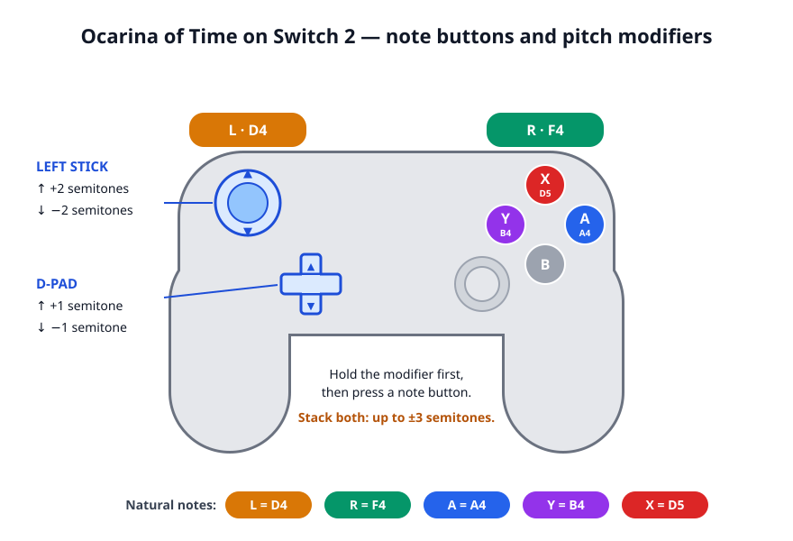
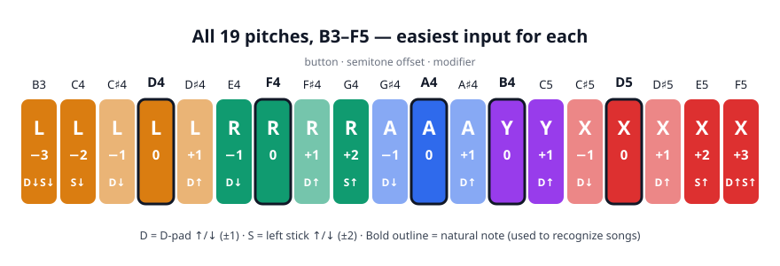

# Zelda: Ocarina of Time (Switch 2) — Ocarina Technical Guide

[简体中文](README.zh-CN.md)

The ocarina in *The Legend of Zelda: Ocarina of Time* on Nintendo Switch 2 has only **five note buttons**, yet it can play a full chromatic range from **B3 to F5 — 19 pitches**. This repository explains how the pitch-bend system works and how to play real songs with it.



## Quick reference

| Button | L | R | A | Y | X |
| --- | :-: | :-: | :-: | :-: | :-: |
| Natural note | D4 | F4 | A4 | B4 | D5 |

| Modifier (hold *before* pressing the note button) | Effect |
| --- | --- |
| D-pad ↑ / ↓ | +1 / −1 semitone |
| Left stick ↑ / ↓ | +2 / −2 semitones |
| Both | up to ±3 semitones |

- 5 buttons × 3 D-pad states × 3 stick states = **45 inputs → 19 distinct pitches**.
- Pitch bends only work in free play. The game recognizes songs from the five natural notes only.
- Full fingering chart: [`docs/technical-analysis.md`](docs/technical-analysis.md#4-the-full-fingering-chart).



## Contents

| Document | Description |
| --- | --- |
| [Technical analysis (English)](docs/technical-analysis.md) | The design, the math, the full fingering chart, and worked examples: C major scale, "Twinkle, Twinkle", Pachelbel's Canon, and transposing "Happy Birthday" |
| [技术分析（简体中文）](docs/technical-analysis.zh-CN.md) | 中文版 |
| [`assets/images/`](assets/images) | Diagrams in SVG and 2× PNG, in English and Chinese |
| [`tools/generate-diagrams.mjs`](tools/generate-diagrams.mjs) | Script that generates every diagram |
| [Score → fingering converter](docs/score-to-fingering.md) | How the converter works (design notes), with code in [`src/`](src/ocarina.mjs) and a CLI in [`bin/`](bin/score-to-ns2.mjs) |

## Score → fingering converter

Turn a melody written as note names into Switch 2 ocarina inputs, optionally transposing it into the playable range (Node.js 18+, no dependencies):

```bash
node bin/score-to-ns2.mjs "E5 D5 C5 B4 | A4 G4"
node bin/score-to-ns2.mjs "F#5 E5 D5 C#5" --auto      # pick the easiest transposition
npm test
```

How it works: [docs/score-to-fingering.md](docs/score-to-fingering.md).

## Regenerating the diagrams

Requires Node.js 18+. The PNGs are rendered from the SVGs with any browser or SVG tool.

```bash
node tools/generate-diagrams.mjs assets/images
```

## Sources and credits

- Per-pitch fingering data cross-checked against the community chart [LoZ Ocarina Note Charts](https://github.com/diacoviello/LoZ-Ocarina-Note-Charts), which also lists every alternative input and fingerings for all 12 major keys.
- Pachelbel's Canon melody checked against the first-violin part of the Mutopia Project edition of *Canon per 3 Violini e Basso*.
- Pitch names follow the original game's layout (L = D4 … X = D5). Nintendo hasn't published the remake's sounding octave, so read octave numbers as written pitch.

## Contributing

Found a wrong fingering or want to add a song? See [CONTRIBUTING.md](CONTRIBUTING.md).

## License

- Text and diagrams: [CC BY 4.0](LICENSE-CONTENT)
- Code (`tools/`): [MIT](LICENSE)

*The Legend of Zelda* and *Ocarina of Time* are trademarks of Nintendo. This is an unofficial fan project and isn't affiliated with or endorsed by Nintendo.

Also published at <https://jiaqihuang.fyi/en/blog/ocarina-ns2-technical-analysis>.
