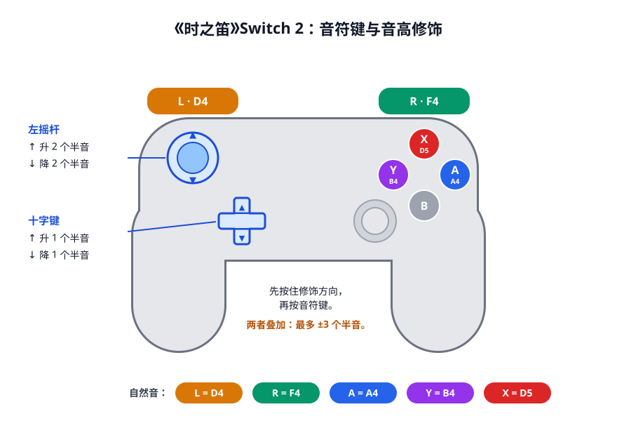
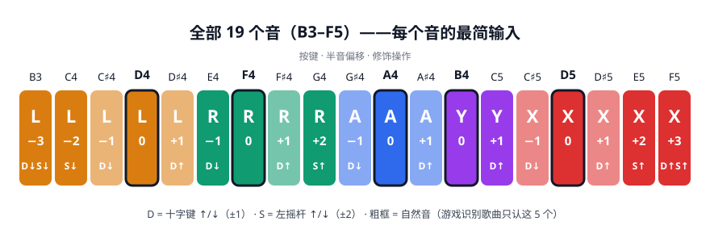

# 《塞尔达传说：时之笛》Switch 2 版陶笛技术指南

[English](README.md)

Switch 2 版《时之笛》的陶笛只有 **5 个音符键**，却能演奏 **B3–F5 的完整半音阶，共 19 个音**。这个仓库解释它的音高修饰机制，以及怎么用它弹出现实中的歌。



## 速查

| 按键 | L | R | A | Y | X |
| --- | :-: | :-: | :-: | :-: | :-: |
| 自然音 | D4 | F4 | A4 | B4 | D5 |

| 修饰操作（先按住，再按音符键） | 效果 |
| --- | --- |
| 十字键 ↑ / ↓ | 升 / 降 1 个半音 |
| 左摇杆 ↑ / ↓ | 升 / 降 2 个半音 |
| 两者叠加 | 最多 ±3 个半音 |

- 5 个键 × 3 种十字键状态 × 3 种摇杆状态 = **45 种输入 → 19 个不同的音**。
- 音高修饰只在自由演奏时生效，游戏识别歌曲只认 5 个自然音。
- 完整指法表见 [`docs/technical-analysis.zh-CN.md`](docs/technical-analysis.zh-CN.md#4-完整指法表每个音取最简单的输入)。



## 内容

| 文档 | 说明 |
| --- | --- |
| [技术分析（简体中文）](docs/technical-analysis.zh-CN.md) | 设计原理、数学分析、完整指法表，以及实战案例：C 大调音阶、《小星星》、《卡农》、《生日快乐》移调 |
| [Technical analysis (English)](docs/technical-analysis.md) | 英文版 |
| [`assets/images/`](assets/images) | 中英文图示，提供 SVG 和 2 倍 PNG（可直接发小红书） |
| [`tools/generate-diagrams.mjs`](tools/generate-diagrams.mjs) | 生成全部图示的脚本 |
| [乐谱 → 指法转换器](docs/score-to-fingering.zh-CN.md) | 转换器的设计说明，代码在 [`src/`](src/ocarina.mjs)，命令行在 [`bin/`](bin/score-to-ns2.mjs) |

## 乐谱 → 指法转换器

把用音名写的旋律转成 Switch 2 陶笛的按键输入，还能自动移调到可演奏的音域（Node.js 18+，无依赖）：

```bash
node bin/score-to-ns2.mjs "E5 D5 C5 B4 | A4 G4" --lang zh
node bin/score-to-ns2.mjs "F#5 E5 D5 C#5" --auto      # 自动选最容易弹的移调
node bin/score-to-ns2.mjs --image score.png --auto    # 从图片读取音符（需要视觉 API 密钥）
npm test
```

原理见 [docs/score-to-fingering.zh-CN.md](docs/score-to-fingering.zh-CN.md)。

## 重新生成图示

需要 Node.js 18+。PNG 用浏览器或任意 SVG 工具由 SVG 渲染。

```bash
node tools/generate-diagrams.mjs assets/images
```

## 资料来源

- 指法数据对照了社区整理的 [LoZ Ocarina Note Charts](https://github.com/diacoviello/LoZ-Ocarina-Note-Charts)，其中还有每个音的所有备选输入和 12 个大调的练习指法。
- 《卡农》旋律对照了 Mutopia Project 版《Canon per 3 Violini e Basso》的第一小提琴声部。
- 音名沿用原版的布局（L = D4 … X = D5）。任天堂没有公布重制版实际发声的八度，所以八度编号请当作记谱音高。

## 参与贡献

发现指法有误，或想补充曲目？见 [CONTRIBUTING.md](CONTRIBUTING.md)。

## 许可

- 文字与图示：[CC BY 4.0](LICENSE-CONTENT)
- 代码（`tools/`）：[MIT](LICENSE)

*《塞尔达传说》和《时之笛》是任天堂的商标。这是非官方的粉丝项目，与任天堂无关。*

同步发布于 <https://jiaqihuang.fyi/zh/blog/ocarina-ns2-technical-analysis>。
