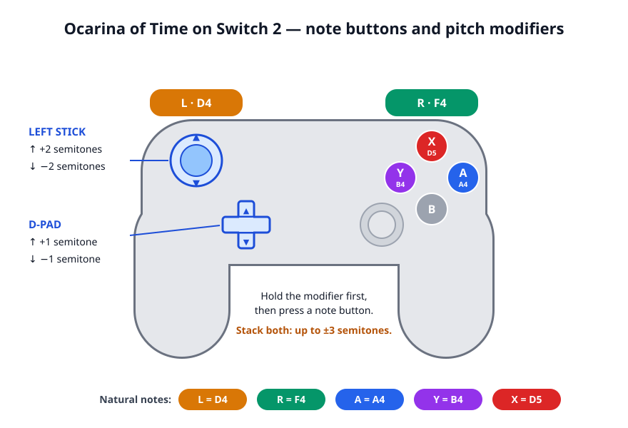
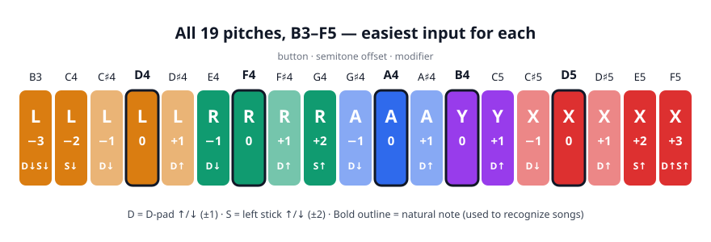
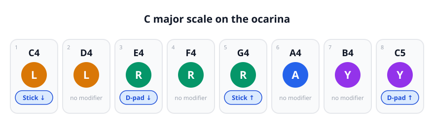
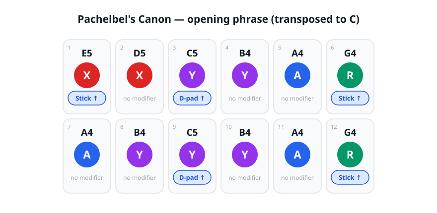
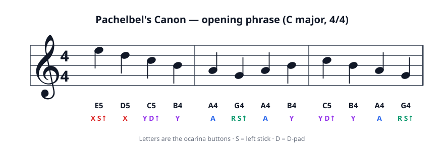

# 5 buttons, 19 notes — a technical look at the Ocarina in Ocarina of Time (Switch 2)

[简体中文](technical-analysis.zh-CN.md) · [Back to README](../README.md)


Everyone who has played *Ocarina of Time* knows the ocarina has just **five note buttons**, and every song in the game (Zelda's Lullaby, Epona's Song, the Song of Time…) is built from them. It's easy to conclude that **the ocarina has five notes**.

It doesn't. **The five buttons are only the "natural" notes. The real range is B3 to F5 — 19 semitones.** This post covers two things: how the system is designed, and how to use it to play real-world melodies.



## 1. The five natural notes

On Switch 2 the five note buttons map to the five N64 buttons like this:

| N64 original | A | C↓ | C→ | C← | C↑ |
| --- | :-: | :-: | :-: | :-: | :-: |
| **Switch 2** | L | R | A | Y | X |
| **Pitch** | D4 | F4 | A4 | B4 | D5 |

D, F, A, B, D (an octave up) is not a major scale, so pressing the buttons alone will never give you Do Re Mi. The game also recognizes songs from **only these five natural notes** — pitch bends work in free play only.

> A note on octave numbers: community charts use the original game's naming (L = D4 … X = D5). Nintendo hasn't published the remake's sounding octave, so read the numbers as *written* pitch.

## 2. Pitch modifiers: half step + whole step, stackable

Each note button can be bent by two independent controls:

| Control | Effect |
| --- | --- |
| D-pad ↑ / ↓ | ±1 semitone |
| Left stick ↑ / ↓ | ±2 semitones (a whole step) |
| Both together | up to ±3 semitones |

This is a direct descendant of the N64 original, where **R raised the pitch by a half step, Z lowered it by a half step, and the control stick bent the note**. The lowest note, B3, was `A` + `Z` + stick down (D4 − 1 − 2); the highest, F5, was `C↑` + `R` + stick up (D5 + 1 + 2). Switch 2 simply swaps R/Z for the D-pad.

One practical detail: **hold the modifier first, then press the note button**, so the note starts on the right pitch.

## 3. The math: 45 inputs, 19 pitches

Each note button × D-pad (↑ / neutral / ↓) × stick (↑ / neutral / ↓):

```
5 buttons × 3 × 3 = 45 inputs
```

For any button, the pitch offset is:

```
offset = dpad(−1, 0, +1) + 2 × stick(−1, 0, +1)   ∈ [−3, +3]
```

Those 9 combinations produce only **7 distinct offsets**, because some of them collide:

| Offset | Combination |
| :-: | --- |
| +3 | D-pad ↑ + stick ↑ |
| +2 | stick ↑ |
| +1 | D-pad ↑, or D-pad ↓ + stick ↑ |
| 0 | no modifier |
| −1 | D-pad ↓, or D-pad ↑ + stick ↓ |
| −2 | stick ↓ |
| −3 | D-pad ↓ + stick ↓ |

Now look at the gaps between the natural notes, in semitones:

```
D4 ──3── F4 ──4── A4 ──2── B4 ──3── D5
```

The widest gap is 4 semitones (F→A), while every button reaches 3 semitones in each direction. Neighboring buttons therefore always overlap, so **there are no holes between B3 (D4 − 3) and F5 (D5 + 3)** — that's why the whole chromatic range is covered.

45 inputs for 19 pitches means most pitches have several fingerings, so you can pick the most comfortable one.

## 4. The full fingering chart

Rule of thumb: fewest inputs wins, and the D-pad beats the stick because it lands the pitch exactly. Each cell shows the button, its offset and the modifier (D = D-pad, S = left stick).



| Pitch | Input |
| :-: | --- |
| B3 | L + D-pad ↓ + stick ↓ |
| C4 | L + stick ↓ |
| C♯4 | L + D-pad ↓ |
| **D4** | **L** |
| D♯4 | L + D-pad ↑ |
| E4 | R + D-pad ↓ |
| **F4** | **R** |
| F♯4 | R + D-pad ↑ |
| G4 | R + stick ↑ |
| G♯4 | A + D-pad ↓ |
| **A4** | **A** |
| A♯4 | A + D-pad ↑ |
| **B4** | **Y** |
| C5 | Y + D-pad ↑ |
| C♯5 | X + D-pad ↓ |
| **D5** | **X** |
| D♯5 | X + D-pad ↑ |
| E5 | X + stick ↑ |
| F5 | X + D-pad ↑ + stick ↑ |

Bold rows are the five natural notes. B3 and F5 need the D-pad and the stick at the same time (a "claw grip"), so they're the hardest to hit.

> The data comes from the community chart [LoZ Ocarina Note Charts](https://github.com/diacoviello/LoZ-Ocarina-Note-Charts), which also lists every alternative input for each pitch plus practical fingerings for all 12 major keys.

## 5. Practice 1: the C major scale and "Twinkle, Twinkle"

C major needs C4 through C5:

| Solfège | Do | Re | Mi | Fa | Sol | La | Ti | Do' |
| --- | :-: | :-: | :-: | :-: | :-: | :-: | :-: | :-: |
| Note | C4 | D4 | E4 | F4 | G4 | A4 | B4 | C5 |
| Input | L + stick ↓ | L | R + D-pad ↓ | R | R + stick ↑ | A | Y | Y + D-pad ↑ |

Four of the eight notes need a modifier; the other four are natural notes, so this key is friendly.



"Twinkle, Twinkle, Little Star" is `1 1 5 5 6 6 5 | 4 4 3 3 2 2 1`:

| C | C | G | G | A | A | G |
| :-: | :-: | :-: | :-: | :-: | :-: | :-: |
| L + stick ↓ | L + stick ↓ | R + stick ↑ | R + stick ↑ | A | A | R + stick ↑ |

| F | F | E | E | D | D | C |
| :-: | :-: | :-: | :-: | :-: | :-: | :-: |
| R | R | R + D-pad ↓ | R + D-pad ↓ | L | L | L + stick ↓ |

## 6. Practice 2: Pachelbel's Canon

Canon in D is a great second piece: a long descending line made almost entirely of steps. The famous opening phrase (the first violin's entry) is:

```
F♯5 E5 D5 C♯5 B4 A4 B4 C♯5 | D5 C♯5 B4 A4
```

There's a catch: F♯5 is one semitone above the ocarina's top note (F5), so the original key D major doesn't fit. Transpose down 2 semitones to **C major** and the phrase becomes `E5 D5 C5 B4 A4 G4 A4 B4 | C5 B4 A4 G4`, which spans only G4–E5. Seven of the twelve notes are natural notes, and the rest need a single modifier:



| Note | E5 | D5 | C5 | B4 | A4 | G4 |
| --- | :-: | :-: | :-: | :-: | :-: | :-: |
| Input | X + stick ↑ | X | Y + D-pad ↑ | Y | A | R + stick ↑ |

Two tips:

- **E5 → D5 → C5 can all be played on X using only the stick:** up for E5, neutral for D5, down for C5 (`X + stick ↓` is the alternative fingering for C5 in the chart above). Your thumb never has to leave the stick.
- Hold the stick *before* pressing the note button, especially on the final G4 of each phrase (`R + stick ↑`), so it doesn't start on F4.

Here is the phrase on a staff, with the ocarina button under each note (S = left stick, D = D-pad):



> The melody was checked against the first-violin part of the Mutopia Project edition of *Canon per 3 Violini e Basso*. Only the melody line is covered here, not the ground bass.

## 7. Practice 3: out of range? Transpose.

In C major, "Happy Birthday" spans G4 to G5 (12 semitones), but the ocarina tops out at F5, so the high G5 near the end can't be played.

The ocarina's full range is 19 semitones and the melody only uses 12, so just **transpose the whole song down**. Moving it down 3 semitones (to A major) makes the melody span E4–E5, and every note needs at most one modifier:

| Original (C) | G G A G C B | G G A G D C |
| --- | --- | --- |
| Transposed (A) | E4 E4 F♯4 E4 A4 G♯4 | E4 E4 F♯4 E4 B4 A4 |
| Input | R+D↓ R+D↓ R+D↑ R+D↓ A A+D↓ | R+D↓ R+D↓ R+D↑ R+D↓ Y A |

| Original (C) | G G G' E' C' B A | F' F' E' C' D' C' |
| --- | --- | --- |
| Transposed (A) | E4 E4 E5 C♯5 A4 G♯4 F♯4 | D5 D5 C♯5 A4 B4 A4 |
| Input | R+D↓ R+D↓ X+S↑ X+D↓ A A+D↓ R+D↑ | X X X+D↓ A Y A |

(D = D-pad, S = left stick.)

## 8. In-game songs: just permutations of five notes

The songs the game recognizes use only natural notes. Here are the six utility songs (each is three notes, played twice):

| Song | Notes | Switch 2 buttons |
| --- | --- | --- |
| Saria's Song | F A B F A B | R A Y R A Y |
| Zelda's Lullaby | B D5 A B D5 A | Y X A Y X A |
| Epona's Song | D5 B A D5 B A | X Y A X Y A |
| Sun's Song | A F D5 A F D5 | A R X A R X |
| Song of Time | A D4 F A D4 F | A L R A L R |
| Song of Storms | D4 F D5 D4 F D5 | L R X L R X |

Note that the high D (D5) and the low D (D4) are two different notes — on the N64 they were `C↑` and `A`.

## Wrap-up

It's a surprisingly elegant design:

- **Five buttons** keep in-game song recognition simple.
- **D-pad + stick** are two orthogonal bend axes, which expand the instrument to a full chromatic range with minimal hardware.
- **45 inputs for 19 pitches** gives enough redundancy that you can choose the fingering that suits your hands.

Next up: turning the fingering chart into a small in-browser tool where you can click a pitch and hear it.

---

*The Legend of Zelda* and *Ocarina of Time* are trademarks of Nintendo. This is an unofficial fan analysis and isn't affiliated with or endorsed by Nintendo. Text and diagrams: [CC BY 4.0](../LICENSE-CONTENT). Also published at <https://jiaqihuang.fyi/en/blog/ocarina-ns2-technical-analysis>.
