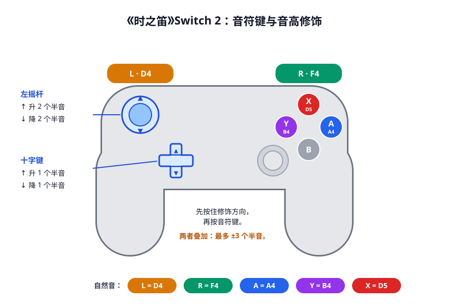
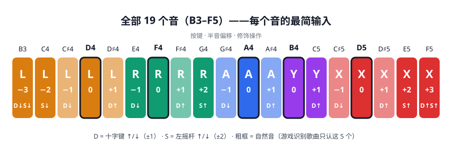
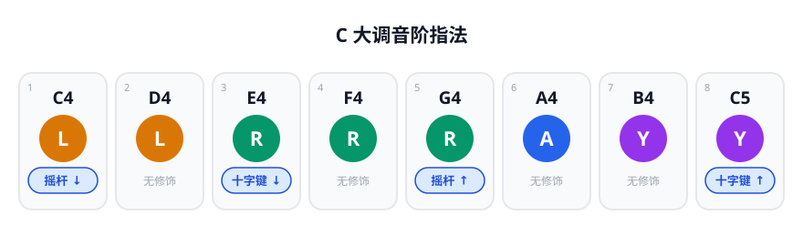
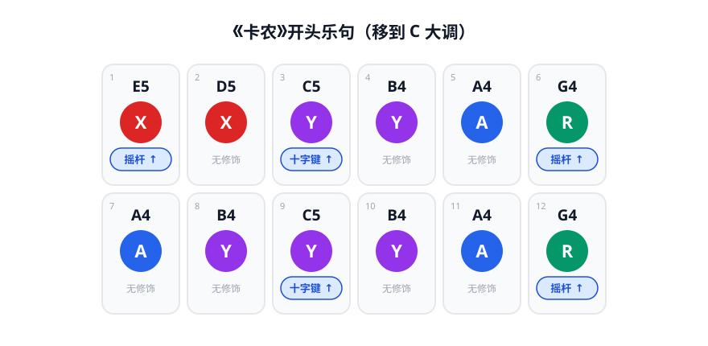
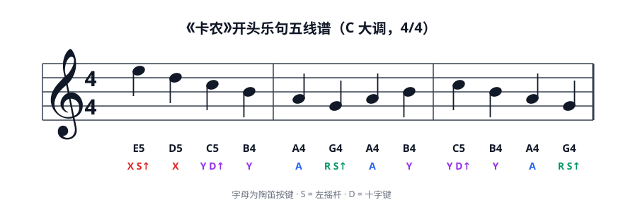

# 5 个按键，19 个音：Switch 2 版《时之笛》陶笛演奏的技术分析

[English](technical-analysis.md) · [返回 README](../README.zh-CN.md)


玩过《时之笛》的人都知道，陶笛只有 **5 个音符键**，游戏里的每首歌（摇篮曲、艾波娜之歌、时之歌……）都是用这 5 个键拼出来的。于是很自然地以为：**陶笛 = 5 个音**。

其实不是。**5 个按键只是"自然音"，真正的音域是 B3 到 F5，一共 19 个半音。** 这篇文章想搞清楚两件事：这个机制是怎么设计的，以及怎么用它弹出现实中的歌。



## 1. 五个自然音

Switch 2 版的 5 个音符键，对应原版 N64 的 5 个按键：

| N64 原版 | A | C↓ | C→ | C← | C↑ |
| --- | :-: | :-: | :-: | :-: | :-: |
| **Switch 2** | L | R | A | Y | X |
| **音高** | D4 | F4 | A4 | B4 | D5 |

这 5 个音是 D、F、A、B、D（高八度）——不是任何一个常见的音阶，所以直接按键是弹不出 Do Re Mi 的。游戏识别"歌曲"也**只认这 5 个自然音**，音高修饰只在自由演奏时生效。

> 关于音名：社区指法表沿用的是原版的音名（L = D4 … X = D5），任天堂没有公布重制版实际发声的八度，所以文中的八度编号请当作"记谱音高"。

## 2. 音高修饰：半音 + 全音，可以叠加

陶笛设计的关键，是在每个音符键上再叠加两种"弯音"：

| 操作 | 效果 |
| --- | --- |
| 十字键 ↑ / ↓ | ±1 个半音 |
| 左摇杆 ↑ / ↓ | ±2 个半音（一个全音） |
| 两者叠加 | 最多 ±3 个半音 |

这套设计其实是 N64 原版的延续：原版是用 **R 键升半音、Z 键降半音、摇杆上下弯音**。比如最低的 B3 是 `A` + `Z` + 摇杆↓（D4 − 1 − 2），最高的 F5 是 `C↑` + `R` + 摇杆↑（D5 + 1 + 2）。Switch 2 版把 R/Z 换成了十字键上下，思路完全一致。

还有一个操作细节：**先按住修饰方向，再按音符键**。这样音符一开始就在目标音高上。

## 3. 数学：45 种输入，19 个音

每个音符键 × 十字键（↑ / 不动 / ↓）× 摇杆（↑ / 不动 / ↓）：

```
5 个键 × 3 × 3 = 45 种输入
```

对任意一个键，最终的音高偏移量是：

```
偏移 = 十字键(−1, 0, +1) + 2 × 摇杆(−1, 0, +1)   ∈ [−3, +3]
```

9 种组合只会产生 **7 种不同的偏移**，因为有几种组合会撞车：

| 偏移 | 组合 |
| :-: | --- |
| +3 | 十字键↑ + 摇杆↑ |
| +2 | 摇杆↑ |
| +1 | 十字键↑，或 十字键↓ + 摇杆↑ |
| 0 | 不修饰 |
| −1 | 十字键↓，或 十字键↑ + 摇杆↓ |
| −2 | 摇杆↓ |
| −3 | 十字键↓ + 摇杆↓ |

再看 5 个自然音之间的间距（以半音数计）：

```
D4 ──3── F4 ──4── A4 ──2── B4 ──3── D5
```

最大的间距是 4 个半音（F→A），而每个键能向两侧各延伸 3 个半音。所以相邻两个键的修饰范围必然重叠，整个 B3（D4 − 3）到 F5（D5 + 3）之间**没有任何空洞**——这就是 19 个半音能被完整覆盖的原因。

45 种输入对应 19 个音，意味着很多音有**多种弹法**。这是后面选指法的关键：同一个音，我们可以挑最顺手的那种。

## 4. 完整指法表（每个音取最简单的输入）

规则是"输入越少越好，十字键优先于摇杆"（十字键是离散的，音高更准）。图中每格依次是按键、半音偏移和修饰操作（D = 十字键，S = 左摇杆）。



| 音高 | 输入 |
| :-: | --- |
| B3 | L + 十字键↓ + 摇杆↓ |
| C4 | L + 摇杆↓ |
| C♯4 | L + 十字键↓ |
| **D4** | **L** |
| D♯4 | L + 十字键↑ |
| E4 | R + 十字键↓ |
| **F4** | **R** |
| F♯4 | R + 十字键↑ |
| G4 | R + 摇杆↑ |
| G♯4 | A + 十字键↓ |
| **A4** | **A** |
| A♯4 | A + 十字键↑ |
| **B4** | **Y** |
| C5 | Y + 十字键↑ |
| C♯5 | X + 十字键↓ |
| **D5** | **X** |
| D♯5 | X + 十字键↑ |
| E5 | X + 摇杆↑ |
| F5 | X + 十字键↑ + 摇杆↑ |

加粗的是 5 个自然音。B3 和 F5 需要左手拇指同时操作十字键和摇杆（所谓"爪形握法"），是最难按的两个音。

> 这张表的数据来自社区整理的 [LoZ Ocarina Note Charts](https://github.com/diacoviello/LoZ-Ocarina-Note-Charts)，里面还有每个音的所有备选输入，以及 12 个大调的练习指法。

## 5. 实战一：C 大调音阶与《小星星》

C 大调（Do Re Mi Fa Sol La Si Do）需要 C4 到 C5：

| 唱名 | Do | Re | Mi | Fa | Sol | La | Si | Do' |
| --- | :-: | :-: | :-: | :-: | :-: | :-: | :-: | :-: |
| 音名 | C4 | D4 | E4 | F4 | G4 | A4 | B4 | C5 |
| 输入 | L + 摇杆↓ | L | R + 十字键↓ | R | R + 摇杆↑ | A | Y | Y + 十字键↑ |

8 个音里有 4 个要用修饰键，其余 4 个是自然音，难度很友好。



《小星星》就是 `1 1 5 5 6 6 5 | 4 4 3 3 2 2 1`：

| C | C | G | G | A | A | G |
| :-: | :-: | :-: | :-: | :-: | :-: | :-: |
| L + 摇杆↓ | L + 摇杆↓ | R + 摇杆↑ | R + 摇杆↑ | A | A | R + 摇杆↑ |

| F | F | E | E | D | D | C |
| :-: | :-: | :-: | :-: | :-: | :-: | :-: |
| R | R | R + 十字键↓ | R + 十字键↓ | L | L | L + 摇杆↓ |

## 6. 实战二：帕赫贝尔《卡农》

《卡农》是很适合的第二首：一条几乎全是级进的下行旋律。最著名的开头乐句（第一小提琴的进入）是：

```
F♯5 E5 D5 C♯5 B4 A4 B4 C♯5 | D5 C♯5 B4 A4
```

有个小问题：F♯5 比陶笛的最高音 F5 还高一个半音，原调 D 大调弹不了。整体**向下移 2 个半音到 C 大调**，乐句就变成 `E5 D5 C5 B4 A4 G4 A4 B4 | C5 B4 A4 G4`，音域只有 G4–E5。12 个音里 7 个是自然音，其余每个只需要一个修饰键：



| 音 | E5 | D5 | C5 | B4 | A4 | G4 |
| --- | :-: | :-: | :-: | :-: | :-: | :-: |
| 输入 | X + 摇杆↑ | X | Y + 十字键↑ | Y | A | R + 摇杆↑ |

两个小技巧：

- **E5 → D5 → C5 可以全部在 X 键上只靠摇杆完成**：上推是 E5，回中是 D5，下推是 C5（`X + 摇杆↓` 是上面指法表里 C5 的备选弹法）。拇指不用离开摇杆。
- 每个乐句最后的 G4（`R + 摇杆↑`）要**先推摇杆再按键**，否则会先发出 F4。

下面是这个乐句的五线谱，每个音符下方标出了陶笛按键（S = 左摇杆，D = 十字键）：



> 旋律对照的是 Mutopia Project 版《Canon per 3 Violini e Basso》的第一小提琴声部。这里只涉及旋律线，不含低音声部。

## 7. 实战三：音域不够怎么办，移调

《生日快乐》在 C 大调里的旋律范围是 G4–G5（12 个半音），而陶笛最高只到 F5，最后一行那个高音 G5 就弹不出来了。

陶笛的总音域有 19 个半音，旋律只占 12 个，所以**整体向下移调**就行。向下移 3 个半音（到 A 大调），旋律范围变成 E4–E5，最低音和最高音都只需要一个修饰键：

| 原调 (C) | G G A G C B | G G A G D C |
| --- | --- | --- |
| 移调后 (A) | E4 E4 F♯4 E4 A4 G♯4 | E4 E4 F♯4 E4 B4 A4 |
| 输入 | R+↓ R+↓ R+↑ R+↓ A A+↓ | R+↓ R+↓ R+↑ R+↓ Y A |

| 原调 (C) | G G G' E C B A | F' F' E' C' D' C' |
| --- | --- | --- |
| 移调后 (A) | E4 E4 E5 C♯5 A4 G♯4 F♯4 | D5 D5 C♯5 A4 B4 A4 |
| 输入 | R+↓ R+↓ X+摇杆↑ X+↓ A A+↓ R+↑ | X X X+↓ A Y A |

（表中"↓/↑"指十字键。）

## 8. 游戏内的歌曲：只是 5 个音的排列组合

游戏认的歌曲只用自然音。这里是最常见的几首（每首都是 3 个音的两遍重复）：

| 歌曲 | 音符 | Switch 2 按键 |
| --- | --- | --- |
| 萨莉亚之歌 | F A B F A B | R A Y R A Y |
| 摇篮曲 | B D5 A B D5 A | Y X A Y X A |
| 艾波娜之歌 | D5 B A D5 B A | X Y A X Y A |
| 太阳之歌 | A F D5 A F D5 | A R X A R X |
| 时之歌 | A D4 F A D4 F | A L R A L R |
| 暴风雨之歌 | D4 F D5 D4 F D5 | L R X L R X |

其中的高 D（D5）和低 D（D4）是两个不同的音，在原版里分别是 `C↑` 和 `A` 键。

## 小结

回头看，这套设计相当聪明：

- **5 个按键**保证了游戏里的"识别歌曲"足够简单。
- **十字键 + 摇杆**这两个正交的弯音维度，用最少的硬件扩展出了完整的半音阶。
- 45 个输入映射到 19 个音，冗余恰好让你可以挑顺手的指法。

下一步想做的：把这个指法表做成一个能在浏览器里点击发声的小工具，放到这个站上。

---

*《塞尔达传说》和《时之笛》是任天堂的商标，本文为非官方的粉丝技术分析，与任天堂无关。文字与图示采用 [CC BY 4.0](../LICENSE-CONTENT) 许可。同步发布于 <https://jiaqihuang.fyi/zh/blog/ocarina-ns2-technical-analysis>。*
